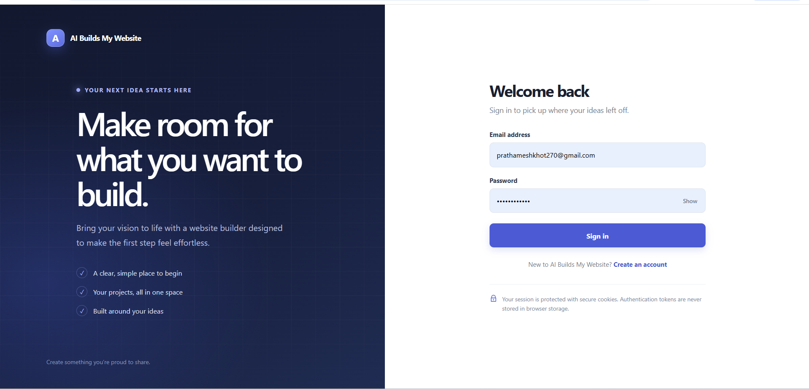

# AI Builds My Website

AI Builds My Website is an AI-powered website builder that transforms a business owner's information, documents, links and confirmed business facts into an editable, single-page website.

The application combines business research, document extraction, AI-powered fact extraction, owner verification, website generation, editing and public publishing.

Built using Laravel, React, Vite and MySQL.

## Screenshots

### 1. Login



### 2. Dashboard


### 3. Business Projects


### 4. AI Business Research


### 5. Fact Extraction and Verification


### 6. Website Builder and Editing


### 7. Website Publishing


### 8. Published Website


### 9. Unpublishing Website


## Key Features

- Business project creation and management.
- PDF document uploads and text extraction.
- Business research using Tavily.
- AI-powered fact extraction using Google Gemini.
- Evidence-based fact review and owner confirmation.
- Conflict handling for business information.
- AI-powered single-page website generation.
- Website editing and individual section regeneration.
- Website revision management.
- Public website publishing and unpublishing.
- Predefined React website templates.
- Private source document storage and controlled public image access.

## Technology Stack

| Layer | Technology |
|---|---|
| Backend | Laravel 13, PHP 8.3 |
| Frontend | React, Vite |
| Database | MySQL 8+ |
| Authentication | Laravel Sanctum |
| AI | Google Gemini |
| Web Research | Tavily |
| PDF Extraction | PHP PDF Parser |
| Background Jobs | Laravel Database Queue |
| API | REST API |

## Requirements

- PHP 8.3 and Composer
- MySQL 8+
- Node.js and npm
- Tavily API key for web research
- Gemini API key for AI features

## Local Setup

### 1. Backend Setup

Navigate to the `backend/` directory:

```powershell
Copy-Item .env.example .env
composer install
php artisan key:generate
```

Configure your MySQL credentials and API keys in `backend/.env`:

```dotenv
DB_CONNECTION=mysql
DB_HOST=127.0.0.1
DB_PORT=3306
DB_DATABASE=ai_website_builder
DB_USERNAME=root
DB_PASSWORD=

TAVILY_API_KEY=
GEMINI_API_KEY=
GEMINI_MODEL=gemini-3.5-flash-lite
```

Never commit `.env` or expose provider credentials in frontend environment variables.

### 2. Run Database Migrations

```powershell
php artisan migrate
```

### 3. Start the Laravel API

```powershell
php artisan serve --host=localhost --port=8000
```

### 4. Start the Queue Worker

In another backend terminal:

```powershell
php artisan queue:work database --timeout=60
```

The queue worker processes source extraction, business research, fact extraction and website generation jobs.

### 5. Frontend Setup

Navigate to the `frontend/` directory:

```powershell
npm install
npm run dev
```

Open the Vite development URL in your browser.

The frontend defaults to the Laravel API at `http://localhost:8000/api`.

## Application Workflow

1. Register and log in.
2. Create a business project.
3. Add business details, links and source documents.
4. Extract information from uploaded PDFs.
5. Research the business using Tavily.
6. Extract candidate facts using Gemini.
7. Review evidence and confirm or reject facts.
8. Generate a website using confirmed business information.
9. Edit